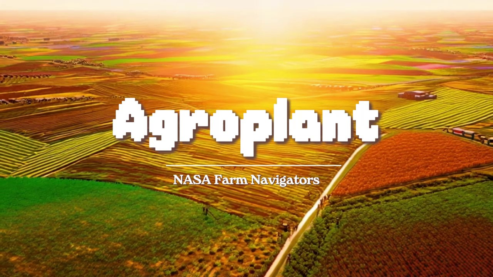
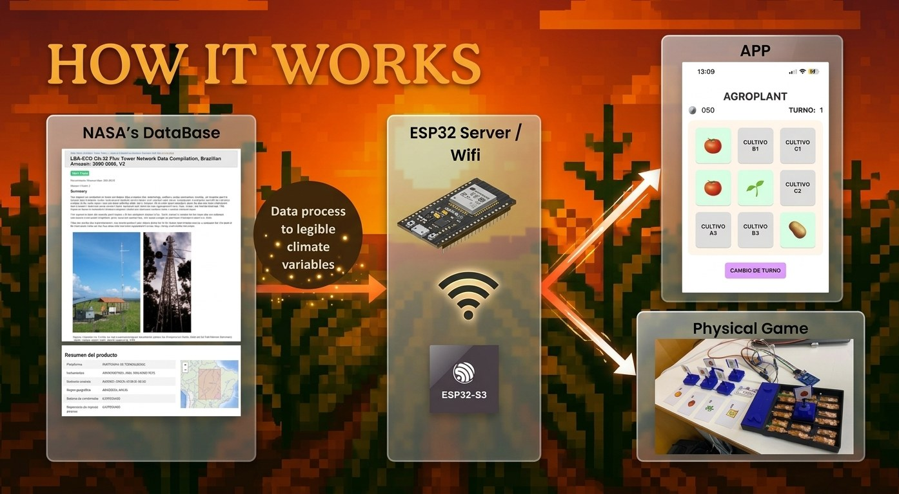
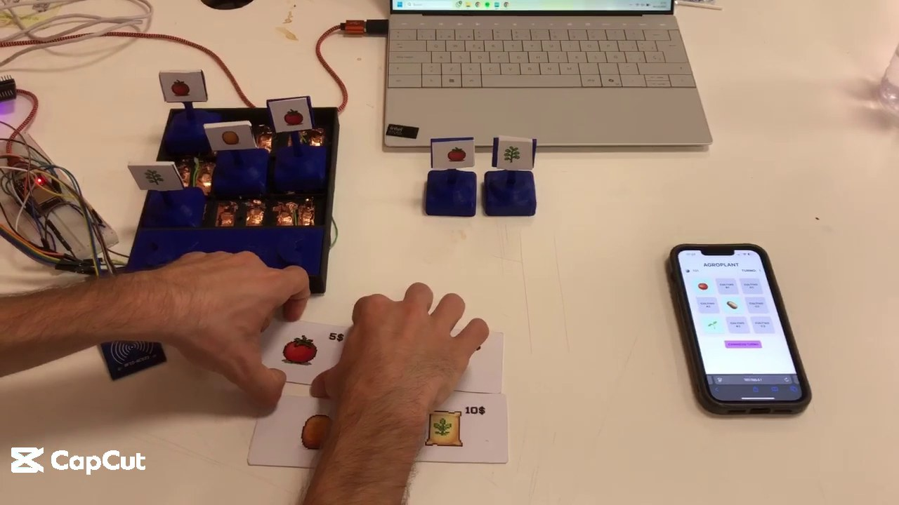
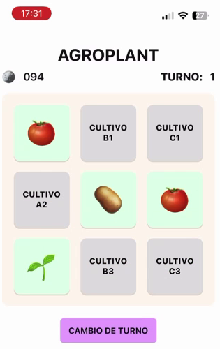
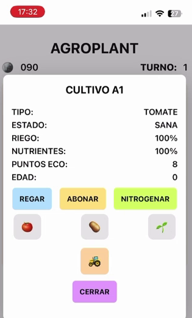
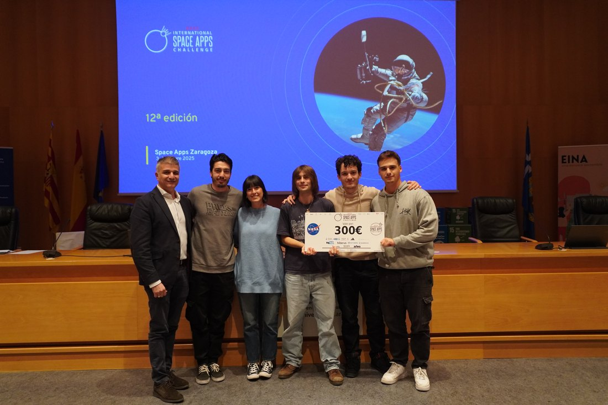

<h1 align="center">AGROPLANT</h1>

<strong>A farming simulator played between a board and a phone.</strong>

  
  

  

## What is AGROPLANT?

**AGROPLANT** is a farming simulator you play with your hands and your phone at the same time. It puts you in the shoes of a farmer trying to bring in a harvest in places where nothing comes easy: the Saudi Arabian desert, deep in the Amazon rainforest, or next to a nuclear power plant in Kazakhstan.

Every game is a mission. You have to grow tomatoes, potatoes or alfalfa, decide when to water and when to fertilize, and make it to the end with the crop still standing, some money in your pocket and the land in good shape. The challenge isn't just about producing more: it's about doing it without overdoing fertilizers, because every decision has a cost for your wallet and for the planet.

## How the game works

  

The game has two halves that talk to each other: a physical board with tiles and sensors, and an app that opens in your phone's browser.

1. **The board is the farm.** Nine plots, A1 to C3, each with a slot for a crop. The board is connected: it has soil sensors and a tile reader.
2. **The tiles are the crops.** Tomato, potato and alfalfa. Each tile carries an RFID chip, like a building access fob.
3. **Hold a tile up to the reader.** The app recognizes the crop and updates that plot on your phone. Nothing to install: your phone joins the board's Wi-Fi and opens the app in the browser.
4. **Check the plot report.** Crop type, condition, watering, nutrients, eco points and age.
5. **Make a decision.** Water, fertilize or apply nitrogen. Every action spends part of your budget and has consequences.
6. **End the turn.** Time moves on, the crop ages and the scenario's climate takes its toll.
7. **Complete the mission.** Harvest, sell, and finish with the crop still standing, money in your pocket and the land in good shape.

   
  The board, the tiles, the budget and the app: this is how it plays.

## The app

The app is the player's field notebook. The main screen shows the nine plots and the current turn; open a plot and its card appears.

| Plots | Crop details |
| :---: | :---: |
|  |  |
| The farm at a glance | Watering, nutrients, eco points and age |

| In the app | What it tells you |
| --- | --- |
| **TYPE** | Tomato, potato or alfalfa. |
| **CONDITION** | How the crop is doing. |
| **WATERING** | From 0 to 100%. |
| **NUTRIENTS** | From 0 to 100%. |
| **ECO POINTS** | How environmentally friendly the crop is. |
| **AGE** | Turns since it was planted. |

And these actions:

- **Water** — tops up the plot's water.
- **Fertilize** — raises nutrients.
- **Apply nitrogen** — nitrogen fertilizer: boosts production, but lowers eco points and the crop's value.
- **End turn** — moves time forward.

## Three places, three problems

The scenarios aren't just backdrops: each has its own climate, soil and difficulty.

- **Saudi Arabia** — heat, sun and very little water. Every drop counts.
- **The Amazon** — humidity, rain and vegetation that doesn't forgive. Too much is also a problem.
- **Kazakhstan** — an industrial setting next to a nuclear power plant, not the first place you'd expect to farm.

And these aren't made-up climates: they come from real NASA data.

## Videos

If you want to see it in motion:

| | Video | What it shows |
| :---: | --- | --- |
| ▶ | **[Demo (31 s)](media/agroplant-demo.mp4)** | From designing the board to a real-time game. |
| ▶ | **[Explanation (1 min 10 s)](media/agroplant-explicacion.mp4)** | The team explains what AGROPLANT is and how it plays. |

Both videos are in the repository, under `media/`, in MP4 format. GitHub doesn't play videos inline in a README, so the links open each file in the repository.

## Why we built it

Because farming is usually explained through headlines: drought, prices, fertilizers, emissions. We wanted people to understand it with their hands: to feel the sting of spending their budget, the temptation of nitrogen, and to see that a harvest doesn't just happen.

AGROPLANT isn't trying to prove anyone right or wrong: it's trying to put the player in the shoes of someone who has to decide with the climate against them, just enough money, and the land at stake.

## Real NASA data

To keep the scenarios grounded, the game draws on public NASA data. The extractor [`data/clima_json_microclimas.py`](data/clima_json_microclimas.py) downloads daily series from **NASA POWER** — temperature, precipitation, humidity and solar radiation — for an area and turns them into microclimate variables. That's the raw material behind each level's conditions. The project also explored **NASA AppEEARS** data to characterize different ecosystems.

[Extractor instructions →](data/README.md)

## Team and award

**Diego López Esteban · Martín Rincón Gálvez · Sergio Toro Codo**

AGROPLANT was submitted to the **NASA Farm Navigators** challenge at the **2025 NASA Space Apps Challenge**, **Space Apps Zaragoza** (12th edition, October 4–5, 2025). The project won a local award at the event.

   
  Space Apps Zaragoza 2025 awards ceremony.

## License

The **code** in this repository — including the extractor in `data/` — is released under the [MIT license](LICENSE).

The **videos, photographs, illustrations, the AGROPLANT name and the game design** are not covered by that license: they are © 2025 Diego López Esteban, Martín Rincón Gálvez and Sergio Toro Codo, all rights reserved. If you want to use any of these materials, please ask the authors for permission.

  © 2025 Diego López Esteban · Martín Rincón Gálvez · Sergio Toro Codo · Zaragoza 
  Data: <a href="https://power.larc.nasa.gov/">NASA POWER</a> · <a href="https://appeears.earthdatacloud.nasa.gov/">NASA AppEEARS</a> · Event: <a href="https://www.spaceappschallenge.org/">NASA Space Apps Challenge</a> 
  More projects at <a href="https://github.com/sejotta">github.com/sejotta</a>

